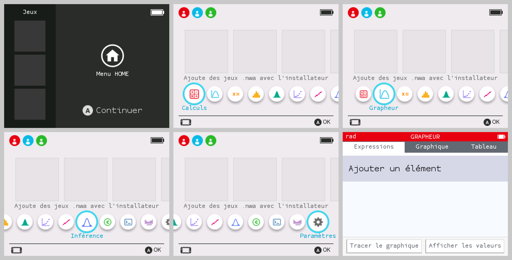
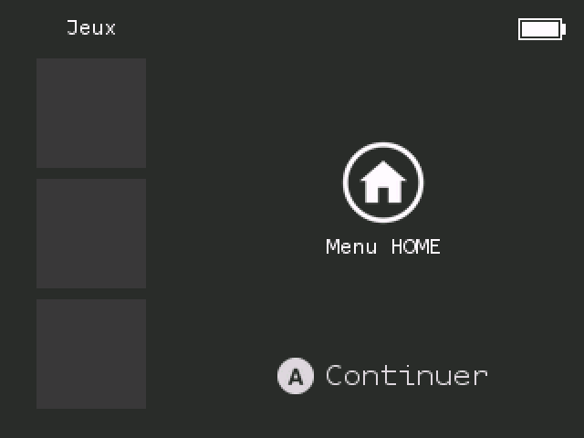
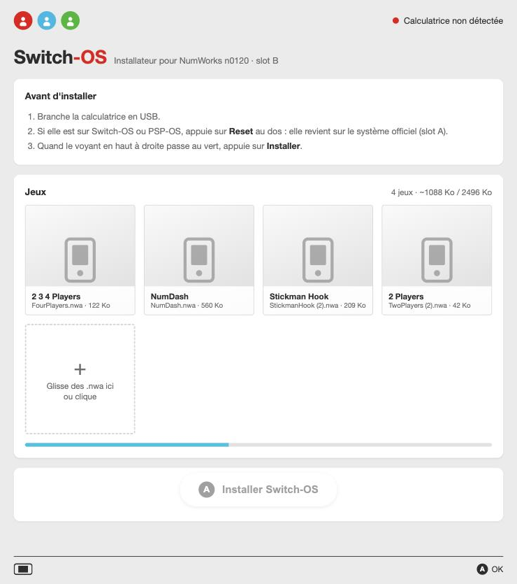

# Switch-OS : le menu HOME de la Switch sur NumWorks

**Switch-OS remplace l'écran d'accueil de la calculatrice NumWorks (n0110, n0115 ou n0120) par
un menu inspiré du menu HOME de la Nintendo Switch** : tes jeux `.nwa` en
grandes vignettes au centre, les applis de la calculatrice en boutons ronds en
bas, et l'écran « Menu HOME / Ⓐ Continuer » au démarrage.



<p align="center"></p>

> Les captures viennent du simulateur, qui ne sait pas charger de jeux : les
> vignettes y sont vides. Sur la calculatrice, chaque vignette affiche
> l'icône du jeu, avec son nom en cyan au-dessus quand il est sélectionné.

## Ce que fait Switch-OS

- **Écran « Menu HOME » au démarrage** : fond sombre, maison, « Ⓐ Continuer »
  qui pulse, et tes trois premiers jeux dans la colonne de gauche. **OK** pour
  entrer.
- **Les jeux au centre** : chaque appli `.nwa` devient une grande vignette avec
  sa propre icône, suivie d'emplacements vides comme sur la console. La vignette
  choisie a un cadre cyan qui pulse et son titre au-dessus.
- **Les applis en bas** : boutons ronds blancs avec une icône de couleur
  (Calculs, Grapheur, Équations, Statistiques… et Paramètres à la fin) ; le
  bouton choisi grossit, prend l'anneau cyan et affiche son nom.
- **Barre du haut** (joueurs, batterie) et **barre du bas** (console, « Ⓐ OK »).
- **Commandes** : ◀ ▶ dans une rangée, ▲ vers les jeux, ▼ vers les applis,
  OK ou EXE pour lancer.
- **Animations** : défilement fluide des rangées, passage d'une rangée à
  l'autre, cadre et anneau qui pulsent, fondu à l'ouverture du menu.
- **Barre de titre rouge** dans les applis, au lieu du jaune NumWorks.
- **Installateurs en un clic pour Mac et pour Windows** : une page web
  locale qui détecte la calculatrice, gère tes jeux (glisser-déposer) et
  installe tout avec un bouton. Sur Windows, un simple `.exe` : rien à
  installer, ni Python ni pilote.



## Installation

### 1. Obtenir Switch-OS

Depuis juillet 2021, le code d'Epsilon (le logiciel de la NumWorks) n'est plus
sous licence libre. Switch-OS ne publie donc **aucun code ni aucun firmware de
NumWorks** : seulement un **patch** (`patches/switch-os-epsilon.patch`) et son
propre code. Le firmware se compile à partir des sources officielles de
NumWorks, dans ton compte GitHub ou sur ton Mac.

**Sans rien compiler (Mac ou Windows)**

1. En haut de cette page : **Use this template** > **Create a new repository**,
   coche **Private** (obligatoire : la compilation refuse de tourner dans un
   dépôt public, pour que le firmware ne soit pas téléchargeable par tous).
2. Facultatif : ajoute tes jeux `.nwa` dans le dossier `games/` de ta copie
   privée (*Add file* > *Upload files*). Ils seront préparés et inclus dans
   l'installateur.
3. Dans ta copie : onglet **Actions** > **Build Switch-OS** > **Run workflow**.
4. Environ 30 minutes plus tard (un firmware par modèle), en bas de la page de la compilation,
   télécharge **Switch-OS-Mac** ou **Switch-OS-Windows** et décompresse-le
   (deux fois pour la version Mac : GitHub met le zip dans un zip).

**En compilant sur ton Mac**

```bash
brew install make dfu-util libusb
brew install --cask gcc-arm-embedded
git clone https://github.com/derim00/switch-os.git && cd switch-os
./scripts/build-firmware.sh
```

Le script télécharge Epsilon au commit indiqué dans `EPSILON_COMMIT`
(Epsilon 26.1, la dernière version publiée par NumWorks), applique le patch,
compile, prépare les jeux de `games/` et remplit le dossier `installer/`.

### 2. Installer sur la calculatrice

**Sur Mac**

1. Une seule fois : `brew install libusb dfu-util` (et
   `brew install --cask gcc-arm-embedded` pour ajouter d'autres jeux).
2. Double-clique sur **`Installer Switch-OS.command`** (la première fois :
   clic droit > **Ouvrir**). La page de l'installateur s'ouvre
   (http://127.0.0.1:8766).

**Sur Windows** (rien à installer : ni Python, ni pilote)

1. Décompresse **Switch-OS-Windows** (clic droit > *Extraire tout*) : ne
   lance pas l'installateur depuis l'intérieur du zip.
2. Dans le dossier `Switch-OS`, double-clique sur **`Installer Switch-OS.exe`**
   (si SmartScreen s'affiche : *Informations complémentaires* > *Exécuter
   quand même*). Une fenêtre noire s'ouvre avec la page de l'installateur dans
   ton navigateur : laisse-la ouverte, et ferme-la à la fin pour quitter.
   Comme pour NumSocial, l'`.exe` contient Python et libusb, et la
   calculatrice se déclare comme périphérique WinUSB : Windows la reconnaît
   sans pilote.

**Ensuite, sur les deux**

3. Branche la calculatrice en USB et appuie sur **Reset** au dos : elle
   redémarre sur le système officiel.
4. Quand le voyant passe au vert, glisse tes jeux `.nwa` dans la page si tu
   veux, puis clique sur **Ⓐ Installer Switch-OS**.

L'installateur vérifie que le **slot B** est libre avant d'écrire : le système
officiel (slot A) n'est jamais modifié. Il prépare les jeux pour leur place
dans le slot B (comme le fait le site de NumWorks), les copie, les relit pour
les vérifier, puis installe Switch-OS et le démarre.

## À savoir

- **Calculatrice** : NumWorks **n0110**, **n0115** ou **n0120**, avec le logiciel officiel
  **26.4.0** dans le slot A. Switch-OS est compilé à partir d'Epsilon 26.1 (la
  dernière version publiée) avec le numéro de version 26.4.0.
- **Trois modèles** : la compilation produit un firmware par modèle
  (n0110, n0115, n0120) et l'installateur choisit tout seul celui de la
  calculatrice branchée. Mets d'abord ta calculatrice à jour sur
  numworks.com : le système doit avoir la même version que le logiciel
  officiel du slot A.
- **Jeux trop gros** : un jeu qui ne tient pas dans le slot B (NumPlay,
  par exemple) est ignoré avec un message, au lieu de faire échouer la
  compilation. Retire-le du dossier `games/`.
- **Après un Reset**, la calculatrice revient sur le système officiel :
  Switch-OS reste dans le slot B, il suffit de relancer l'installation.
- **Un seul système dans le slot B** : Switch-OS remplace
  [PSP-OS](https://github.com/derim00/psp-os) s'il était installé, et
  inversement. Les deux installateurs peuvent tourner en même temps (ports
  8765 et 8766).
- **Touches Home et On/Off** : sur un logiciel non officiel, le système de la
  calculatrice gère lui-même ces deux touches. Switch-OS efface au démarrage le
  point de retour laissé par le système officiel pour que Home ramène au menu ;
  si la calculatrice revient quand même sur le slot A, utilise **Retour** (↩)
  pour revenir au menu depuis une appli.
- **Jeux sur Windows** : les jeux déjà présents dans `games/` lors de la
  compilation sont prêts ; pour en ajouter d'autres directement depuis
  Windows, il faut la chaîne ARM
  ([Arm GNU Toolchain](https://developer.arm.com/downloads/-/arm-gnu-toolchain-downloads),
  version *arm-none-eabi*).
- **Jeux** : seulement des applis `.nwa` dont tu as le droit de te servir, et
  uniquement dans ta copie privée : jamais dans ce dépôt public.

## Comment c'est fait

| Fichier | Rôle |
| --- | --- |
| `patches/switch-os-epsilon.patch` | le menu HOME (`apps/home`), les icônes, les animations (`escher`), la barre rouge |
| `scripts/build-firmware.sh` | télécharge Epsilon, applique le patch, compile, prépare l'installateur |
| `installer/server.py` | serveur local (127.0.0.1 uniquement) de l'installateur, Mac et Windows |
| `installer/dfu_launch.py` | lance l'outil DFU de NumWorks avec libusb (Homebrew ou `libusb-package`) et les correctifs Windows de NumSocial |
| `scripts/build-windows-installer.py` | fait `Installer Switch-OS.exe` avec PyInstaller (sur Windows, dans le workflow) et le teste |
| `installer/index.html` | la page de l'installateur |
| `installer/link_games.py` | place chaque jeu `.nwa` à son adresse dans le slot B, comme le site de NumWorks |
| `installer/Installer Switch-OS.command` | lanceur en double-clic pour Mac |
| `.github/workflows/build.yml` | compilation dans ta copie privée, avec les deux installateurs |

## Licence

Le code de Switch-OS est sous licence **CC BY-NC-SA 4.0** (voir `LICENSE`).
Epsilon reste la propriété de NumWorks et n'est pas inclus dans ce dépôt.
Switch-OS est un projet de fan, sans lien avec Nintendo ni avec NumWorks ;
Nintendo Switch est une marque de Nintendo.
